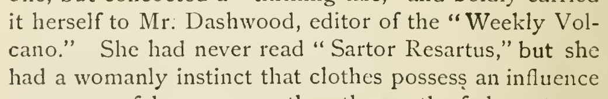

# work subtype correction

Change Sartor Resartus from se:name.publication.magazine to se:name.publication.book in chapter 34. The retained catalogue evidence distinguishes the work from its serial publication venue; the clothes allusion supports the named work locally. This corrects the existing work category under the appropriate-inflection rule, without identifying a particular edition.

| Location | Current → proposed | Exact patch |
| --- | --- | --- |
| [chapter 34, line 17](https://github.com/standardebooks/louisa-may-alcott_little-women/blob/38695106591f6060142dd1ad4da1d2aeded8ab8f/src/epub/text/chapter-34.xhtml#L17) | <code>&lt;i epub:type="se:name.publication.magazine"&gt;Sartor Resartus&lt;/i&gt;</code> → <code>&lt;i epub:type="se:name.publication.book"&gt;Sartor Resartus&lt;/i&gt;</code> | [Patch](../changes/sartor-resartus/baseline.patch) |

[Complete changes and proposed messages](../briefs/rule-work-subtype-correction/appendix.md).

[1915 Little, Brown (Smith illustrations) — 1915 Little, Brown (Smith illustrations) — full page](../assets/image-0270.png).

