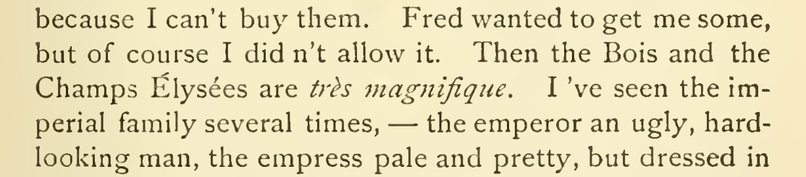

# Restore Champs Élysées

In chapter 31, restore the final s in Champs Élysées, keeping the name in plain roman text. The cited 1915 scan (p. 397) supports the full form, and retained [PG37106](https://www.gutenberg.org/ebooks/37106) also has the plural ending; the existing all-copy review reports no printed singular ending. Amy’s imperfect French makes preservation worth considering, but it supplies no occurrence-specific evidence for deleting this s. Confidence is high for this local repair; neither the exact import exemplar nor the latest authorized edition is established.

| Location | Current → proposed | Exact patch |
| --- | --- | --- |
| [chapter 31, line 58](https://github.com/standardebooks/louisa-may-alcott_little-women/blob/38695106591f6060142dd1ad4da1d2aeded8ab8f/src/epub/text/chapter-31.xhtml#L58) | <code>Élysée</code> → <code>Élysées</code> | [Patch](../changes/champs-elysees/baseline.patch) |

[Complete changes and proposed messages](../briefs/word-champs-elysees/appendix.md).

[1915 Little, Brown (Smith illustrations) — 1915 Little, Brown (Smith illustrations), physical page 417 — full page](../assets/image-0024.png).

