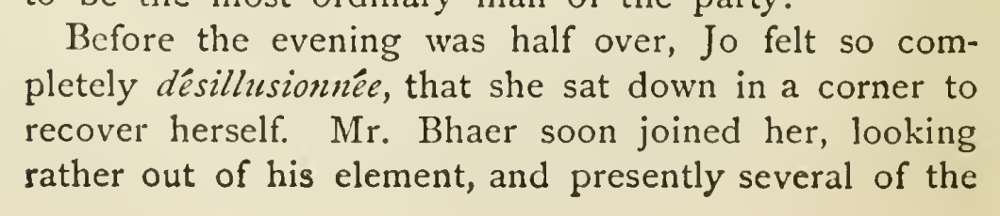

# Restore désillusionnée

In chapter 34, restore désillusionée to désillusionnée, preserving the existing French italic markup. The cited 1915 scan (p. 442) supplies the double n, matching the feminine French form in the sentence about Jo. [PG37106](https://www.gutenberg.org/ebooks/37106) also has the single n, so the current reading cannot be attributed specifically to an SE transcription error. The qualified printed alternative supports this high-confidence local restoration; the exact historical exemplar remains uncertain.

| Location | Current → proposed | Exact patch |
| --- | --- | --- |
| [chapter 34, line 56](https://github.com/standardebooks/louisa-may-alcott_little-women/blob/38695106591f6060142dd1ad4da1d2aeded8ab8f/src/epub/text/chapter-34.xhtml#L56) | <code>&lt;i xml:lang="fr"&gt;désillusionée&lt;/i&gt;,</code> → <code>&lt;i xml:lang="fr"&gt;désillusionnée&lt;/i&gt;,</code> | [Patch](../changes/french-desillusionnee/baseline.patch) |

[Complete changes and proposed messages](../briefs/word-desillusionnee/appendix.md).

[1915 Little, Brown (Smith illustrations) — 1915 Little, Brown (Smith illustrations) — full page](../assets/image-0101.png).

